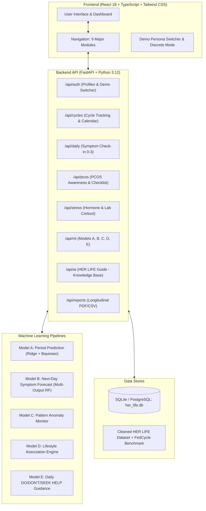

# HER LIFE — AI-Powered Women's Lifetime Health Companion
> **Tagline:** *"Every Stage. Every Cycle. Every You."*

[](https://fastapi.tiangolo.com)
[](https://react.dev)
[](https://scikit-learn.org)
[](https://tailwindcss.com)
[](LICENSE)

---

## 1. Project Overview

**HER LIFE** is a modern, full-stack, AI-powered women's lifetime health companion web application. Beyond standard period tracking, HER LIFE provides personalized endocrine intelligence and holistic lifestyle guidance supporting individuals across five distinct life stages:

1. **Puberty & First Period (Teen Menarche):** Menstrual hygiene guidance, first-period preparation, irregular early cycle education, safeguarding, and trusted-adult support.
2. **Gen Z & College Students:** Exam-stress-aware study planners, timetable-aligned check-ins, sleep tracking, and early PCOS awareness.
3. **Millennials & Reproductive Years:** Period variance analysis, ovulation/fertile window estimation (with strict non-contraception disclaimers), and endometriosis/pain awareness.
4. **Perimenopause:** Vasomotor symptom diary (hot flashes & night sweats), bleeding irregularity tracking, and brain fog monitoring.
5. **Menopause & Later Life:** Post-menopausal symptom monitoring, bone health education, and automated red-flag alerts for post-menopausal bleeding.

---

## 2. System Architecture



---

## 3. Machine Learning Models & Dataset Tuning

### Model A: Period Prediction Engine
- **Input:** Historical recorded period start dates, bleeding duration, and previous cycle length lags ($L_1, L_2, L_3$).
- **Algorithm:** Ridge Regression ($L_2$ regularization) paired with Bayesian credible intervals.
- **Output:** Estimated upcoming period date, uncertainty margin ($\pm 2.5\text{ days}$), and confidence rating (High / Moderate / Low / Insufficient Data).

### Model B: Multi-Target Symptom Forecasting
- **Input:** Age, cycle day estimate, sleep duration, self-reported stress (0–4), activity level, and prior day symptom severities.
- **Targets:** 7 next-day symptoms (`cramps`, `bloating`, `headache`, `fatigue`, `mood_changes`, `hot_flashes`, `sleep_disturbance`).
- **Validation:** **GroupShuffleSplit** grouped by `user_id` to strictly prevent data leakage between records of the same user.
- **Performance:** **83.5% overall test match rate** across symptom targets.

### Model C: Cycle Pattern Monitoring & Clinical Alerts
- **Rule Engine:** Flags oligomenorrhea ($>38\text{ days}$ for adults, $>45\text{ days}$ for teens), polymenorrhea ($<21\text{ days}$), and excessive cycle variability ($\sigma > 7.0\text{ days}$).

### Model D: Lifestyle Association Engine
- **Methodology:** Computes statistical Pearson/Spearman correlations across daily lifestyle factors.
- **Safety Rule:** Clearly flags that correlations are statistical associations, **not proof of medical causation**.

### Model E: Personalized Routine & Health Guidance
- **Output:** Dynamically renders three structured sections based on the active life stage:
  - **DO:** Evidence-based self-care and sleep habits.
  - **DON'T:** Avoid unverified hormone-balancing remedies and extreme caloric restriction.
  - **WHEN TO SEEK HELP:** Urgent red-flag symptoms requiring in-person clinical care.

---

## 4. Dataset Integration & Cleaning

The system integrates and refines the provided **HER LIFE Synthetic Package** and the **FedCycle Clinical Observational Dataset**:

1. **`users.csv` (240 profiles):** Cleaned age distributions, life-stage mappings, and baseline cycle regularity.
2. **`cycles.csv` (2,521 cycles):** Filtered anomalous non-physiological intervals ($<15$ or $>100$ days), unified bleeding duration, and flow levels.
3. **`daily_model_dataset.csv` (87,600 daily records):** Derived rolling 7-day sleep averages, imputed missing values, and created leak-free train/test splits.
4. **`FedCycleData071012 (2).csv` (1,665 clinical cycles):** Benchmark validation for mean cycle length ($28.7\text{ days}$), luteal phase length, and clinical variability distributions.
5. **Persistent Synthetic Label:** All demo personas feature a persistent, prominent banner: **"DEMO DATA — SYNTHETIC, NOT REAL PATIENT RECORDS."**

---

## 5. Getting Started & Running Locally

### Prerequisites
- Python 3.10+ (Python 3.12 recommended)
- Node.js 18+ and npm

### 1. Clone the Repository
```bash
git clone https://github.com/harshitasikka56-png/HER-LIFE.git
cd HER-LIFE
```

### 2. Backend Setup
```bash
# Create virtual environment
python3 -m venv venv
source venv/bin/activate

# Install dependencies
pip install -r backend/requirements.txt # or: pip install fastapi uvicorn sqlalchemy pydantic pandas scikit-learn joblib httpx python-multipart passlib[bcrypt] pydantic-settings email-validator pytest

# Run ML pipeline & dataset cleaning
python3 backend/ml/train_models.py

# Seed database with demo personas
python3 backend/seed_data.py

# Run Backend Server (port 8001)
uvicorn main:app --app-dir backend --host 0.0.0.0 --port 8001 --reload
```

### 3. Frontend Setup
```bash
cd frontend

# Install dependencies
npm install

# Start Vite Development Server (port 5174)
npm run dev
```

Visit **http://localhost:5174** in your web browser.

### 4. Running Unit & Integration Tests
```bash
# Run backend pytest suite (all 14 test cases)
./venv/bin/pytest tests -v
```

---

## 6. Pre-Configured Demo Personas

Switch between personas in the top-right header dropdown to explore life-stage adaptations:

| Persona | Name | Age | Life Stage | Key Focus Areas |
|---|---|---|---|---|
| **1** | **Maya Lin** | 15 | Puberty / Teen | Newly started cycles, puberty hygiene, backpack pouch guidance |
| **2** | **Chloe Patel** | 21 | Gen Z College | Exam stress, irregular cycles, acne & PCOS awareness |
| **3** | **Priya Sharma** | 29 | Reproductive | Cycle variance, ovulation window estimates, PMS monitoring |
| **4** | **Elena Morales** | 47 | Perimenopause | Hot flashes, night sweats, sleep shifts, brain fog diary |
| **5** | **Sarah Jenkins** | 56 | Menopause | Bone health, post-menopausal symptom diary, red-flag bleeding alerts |

---

## 7. College Project Presentation Outline

### Slide 1: Title & Vision
- **HER LIFE:** AI-Powered Women's Lifetime Health Companion
- Tagline: *"Every Stage. Every Cycle. Every You."*
- Presenter: Harshita Sikka

### Slide 2: Problem Statement
- Most menstrual applications treat all users as generic 28-day menstruators seeking pregnancy or simple period dates.
- Gaps: Lack of life-stage adaptation (teens vs perimenopause), non-scientific diagnostic claims, lack of honest uncertainty in ML, and commercial ad tracking of private reproductive data.

### Slide 3: Technical Architecture
- **Frontend:** React 18, TypeScript, Tailwind CSS, Recharts, Lucide Icons.
- **Backend:** Python FastAPI, SQLAlchemy, SQLite/PostgreSQL, Pydantic schemas.
- **Machine Learning:** Scikit-Learn pipelines, Ridge regression, Multi-Output Random Forest, GroupShuffleSplit cross-validation.

### Slide 4: Dataset Cleaning & Feature Engineering
- Cleaning raw synthetic daily records (87,600 days) and clinical benchmark comparison against 1,665 FedCycle cycles.
- Multi-lag feature engineering ($L_1, L_2, L_3$) and rolling sleep/stress factors.

### Slide 5: Machine Learning Models (A to E)
- **Model A:** Period prediction with Bayesian uncertainty bounds ($\pm 2.5\text{ days}$) and honest confidence ratings.
- **Model B:** Multi-target next-day symptom forecasting ($83.5\%$ match rate).
- **Model C & D:** Clinical pattern flags and lifestyle associations.
- **Model E:** Prescriptive daily DO, DON'T, and WHEN TO SEEK HELP guidance.

### Slide 6: Medical Ethics, Safety & Privacy
- Zero commercial ad monetization.
- Discrete notification previews (protecting privacy on lockscreens).
- Strict non-diagnostic guardrails (distinguishing subjective stress from clinical cortisol; avoiding premature PCOS diagnoses).
- Automated emergency alerts for heavy hemorrhage or severe acute pain.

### Slide 7: Live Demonstration Walkthrough
- Dynamic persona switching across all 5 life stages.
- Daily check-in logging and live Recharts visualizations.
- Interactive PCOS checklist export and conversation with HER LIFE AI Guide.

### Slide 8: Future Scope & Conclusion
- Integration with FHIR / HL7 clinical health records.
- Edge ML inference on mobile devices for zero-cloud confidential tracking.

---

## 8. Medical & Legal Disclaimer

> **IMPORTANT MEDICAL NOTICE:** HER LIFE is an educational health-tracking and machine learning platform. It does **NOT** provide medical diagnoses, treatment prescriptions, or certified natural contraception. All predictions and statistical correlations are educational estimations. Users experiencing persistent, severe, or worsening symptoms should consult a qualified physician or healthcare provider.
